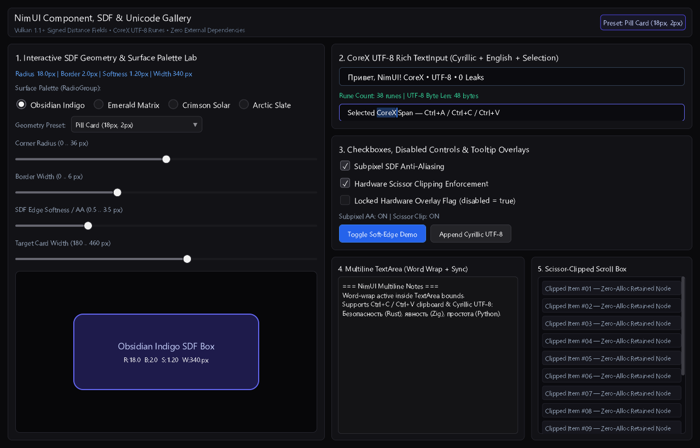
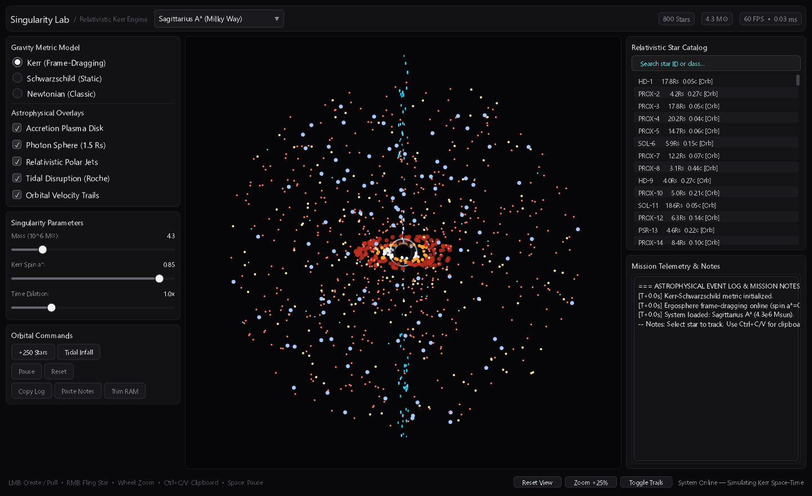
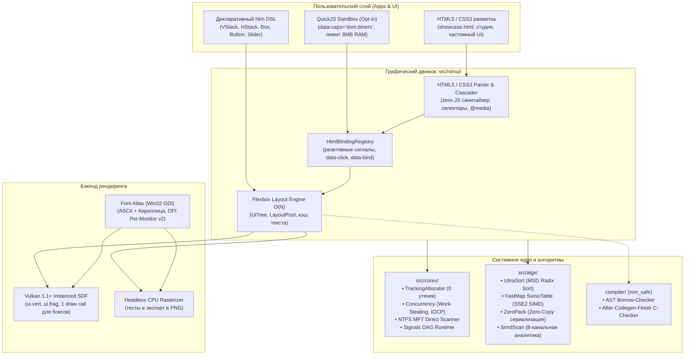

<div align="center">

# NimRT

### Нативный UI-движок и системная библиотека на Nim 2.x

**NimRT — это Windows-first нативный десктопный рантайм и движок на Vulkan 1.1+ SDF, позволяющий выпускать утилиты со стартом <40 мс и ~25 МБ RAM на Nim + практичном подмножестве HTML5/CSS3 без Chromium и Electron.**

[](https://github.com/stylizedapp/nimrt/actions/workflows/ci.yml)
[](https://nim-lang.org/)
[](https://www.vulkan.org/)
[](tests/test_leak_check.nim)
[](docs/PROJECT.md)
[](LICENSE)
[](https://github.com/stylizedapp/nimrt/releases)

---

[Почему Nim](#почему-nim) •
[Сравнение](#сравнение-с-другими-стеками) •
[Примеры](#примеры-приложений) •
[Архитектура](#архитектура) •
[Быстрый старт](#быстрый-старт) •
[Релизы](#что-устанавливать-github-releases) •
[Бенчмарки](#бенчмарки-corex--algx-против-rust) •
[FAQ](#faq)

---

</div>

## О проекте

**NimRT** — это экспериментальная экосистема для десктопных приложений на Nim. Она заменяет тяжёлые браузерные обёртки вроде Electron на нативный рендер и собственный системный стек:

1. **NimUI** — рендеринг подмножества HTML5/CSS3 (включая Flexbox) на GPU через Vulkan 1.1+ SDF. Холодный старт < 40 мс, потребление памяти от ~20–35 МБ, чёткие векторные скругления и тени.
2. **CoreX и AlgX** — системное ядро и алгоритмы: аллокаторы с проверкой утечек (`0 bytes leaked`), прямой парсер NTFS MFT, пул потоков с work-stealing, IOCP-реактор, SIMD-хэш-таблицы и быстрая сортировка.
3. **Безопасность и скриптинг** — модель памяти `--mm:orc` без пауз сборщика мусора, режим **Zero-JS по умолчанию** (вся логика на Nim) и опциональная песочница **QuickJS** с жёсткими лимитами памяти и прав. Также в репозитории есть Component SDK (`src/nimui/sdk/`) с явными разрешениями (`fs`, `network`, `process`, `clipboard`, `notifications`) и экспериментальный проверяющий компилятор `nim_safe`.

> [!NOTE]
> **Фокус и границы проекта:** см. [`docs/FOCUS.md`](docs/FOCUS.md) (первая вертикаль — быстрые локальные Windows-утилиты и dev-инструменты; не является общим веб-браузером или заменой Node.js), [`docs/COMPONENT_SDK.md`](docs/COMPONENT_SDK.md) (контракт блоков и прав) и [`docs/DISTRIBUTION.md`](docs/DISTRIBUTION.md) (политика дистрибуции, подписей и приватности).

---

## Почему Nim

- **Читаемый синтаксис и скорость нативного кода.** Nim компилируется в C/C++ и собирается через GCC, Clang или MSVC с `-O3` и LTO.
- **Память без GC-пауз.** С `--mm:orc` используется детерминированный подсчёт ссылок с доочисткой циклов — интерфейс не подтормаживает из-за «сборки мусора».
- **AST-макросы.** Декларативный UI и реактивные привязки разворачиваются на этапе компиляции без лишних накладных расходов в рантайме.
- **Прямой C FFI.** Подключение Vulkan, Win32 API или QuickJS делается через `{.importc.}` без прослоек и маршалинга.
- **Компактные бинарники.** Итоговые приложения весят 8–15 МБ и запускаются за десятки миллисекунд.

---

## Сравнение с другими стеками

| Критерий | NimRT | Electron | Tauri | Flutter Desktop | Qt / C++ |
| :--- | :---: | :---: | :---: | :---: | :---: |
| **Рендеринг** | Vulkan 1.1+ Instanced SDF | Chromium | WebView2 / WebKit | Impeller / Skia | Qt Quick (SceneGraph) |
| **Язык логики** | Nim 2.x (+ QuickJS опционально) | JS / TS | Rust + JS | Dart | C++ / QML |
| **Холодный старт** | ~25–40 мс | 2 500–4 000 мс | 300–800 мс | 200–500 мс | ~50–150 мс |
| **RAM в покое** | ~20–35 МБ | 180–350 МБ | 70–150 МБ | 60–120 МБ | ~30–50 МБ |
| **Размер сборки** | ~8–15 МБ | 120–250 МБ | 15–30 МБ | 35–70 МБ | 40–100 МБ (DLL) |
| **Память** | ARC/ORC (без стоп-пауз) | V8 GC | Borrow Checker | Generational GC | Ручное / SmartPtr |
| **Вёрстка** | HTML5 / CSS3 Flexbox | Полный HTML/CSS | Полный HTML/CSS | Виджет-DSL | QML / C++ |
| **Скрипты** | Zero-JS по умолчанию | Node/NPM | Web context | Скомпилирован | Скомпилирован |

---

## Примеры приложений

Все демо-приложения собираются в нативные `.exe` и работают как в оконном режиме на Vulkan, так и в headless-режиме через встроенный CPU-растеризатор (для тестов и снятия скриншотов).

### 1. `apps/html_css_studio` — студия HTML5/CSS3
Демонстрация рендера, форм, песочницы Zero-JS и виртуализированного списка на 1 000 000 строк:

| Вкладка 1: Дашборд и KPI | Вкладка 2: Формы и контролы |
| :---: | :---: |
| [](apps/html_css_studio/screenshots/studio_tab1_dashboard.png) | [](apps/html_css_studio/screenshots/studio_tab2_forms_controls.png) |
| *Flexbox-сетка, градиенты, карточки, кнопки* | *Слайдеры, чекбоксы, выпадающие списки, инпуты* |

| Вкладка 3: Zero-JS Security Sandbox | Вкладка 4: VirtualList на 1 000 000 строк |
| :---: | :---: |
| [](apps/html_css_studio/screenshots/studio_tab3_zero_js_sandbox.png) | [](apps/html_css_studio/screenshots/studio_tab4_virtual_million.png) |
| *Блокировка скриптов и инъекций по умолчанию* | *Плавная прокрутка списка из 1M элементов* |

### 2. `apps/widget_gallery` и `apps/nimui_demo`
Галерея SDF-виджетов и N-body симуляция с HTML-оверлеем:

| Галерея виджетов | Singularity Lab |
| :---: | :---: |
| [](apps/widget_gallery/widget_gallery_preview.png) | [](apps/nimui_demo/singularity_lab_preview.png) |
| *Скругления, тени, обрезка, кириллица и выпадающие списки* | *Симуляция 2048+ тел с наложенным HTML-интерфейсом* |

### 3. `apps/html_desktop` — автономный запуск HTML-файлов
Рендер локальных `.html` страниц напрямую через Vulkan без браузера (на примере Pomodoro-таймера на QuickJS):

| Начальное состояние | Завершение сессии |
| :---: | :---: |
| [](apps/html_desktop/pomodoro_initial.png) | [](apps/html_desktop/pomodoro_completed.png) |
| *QuickJS + Vulkan SDF с лимитом шагов* | *Реактивное обновление DOM и стилей* |

---

## Архитектура



---

## Быстрый старт

### Требования
- **ОС:** Windows 10/11 x64
- **Компилятор:** [Nim 2.0+](https://nim-lang.org/install_windows.html) (проверено на `2.2.12`) и MinGW-W64 GCC в `PATH`
- **GPU:** драйвер с поддержкой **Vulkan 1.1+** (headless-тесты работают на CPU и без него)

### Установка и запуск демо
```powershell
git clone https://github.com/stylizedapp/nimrt.git
cd nimrt

# HTML5/CSS3 Zero-JS Studio (4 вкладки, VirtualList на 1M строк)
nimble studio

# Галерея виджетов и настроек Vulkan SDF
nimble gallery

# Симуляция Singularity Lab
nimble demo
```

### Запуск своего HTML-файла
```powershell
nim c -r apps/html_desktop/src/main.nim --file path/to/your_file.html
```

### Что устанавливать (GitHub Releases)

Если вы не хотите собирать из исходников, скачайте готовые автономные сборки со страницы [GitHub Releases](https://github.com/stylizedapp/nimrt/releases) (Chromium, WebView2 и Node.js не требуются):

- **`nimrt-vX.Y.Z-win64-portable.zip`** *(рекомендуется)* — портативный архив со всеми бинарниками и документацией.
- **`html_desktop.exe`** — автономный рендерер локальных `.html` приложений (Zero-JS по умолчанию + опциональный QuickJS).
- **`wiztree.exe`** — консольный анализатор диска через NTFS `$MFT` / Win32.
- **`widget_gallery.exe`** — витрина SDF-виджетов и типографики на Vulkan 1.1+.
- **`nim_safe.exe`** — экспериментальный проверяющий компилятор (`--mem-safe`, `--check-safe-atf`).
- **`SHA256SUMS.txt`** — контрольные суммы для проверки целостности неподписанных MVP-сборок (подробнее — в [`docs/RELEASES.md`](docs/RELEASES.md) и [`docs/DISTRIBUTION.md`](docs/DISTRIBUTION.md)).

---

## Бенчмарки CoreX + AlgX против Rust

> [!NOTE]
> Замеры выполнены в одинаковых условиях (`Warmup = 2`, `Runs = 11`, AMD Ryzen 3 3200U 2C/4T, Windows x64).
> Компиляторы: **Nim 2.2.12** (`-d:danger --mm:orc -march=native -O3 -flto`, MinGW GCC) против **Rust 1.96.0** (`lto=fat`, `target-cpu=native`, MSVC/LLVM).
> Методология и подробности — в [`docs/BENCHMARK_SHOWCASE.md`](docs/BENCHMARK_SHOWCASE.md).

| Задача | Реализация | Медиана | Среднее | Итог |
| :--- | :--- | :---: | :---: | :---: |
| **UltraSort** (10M `int64`, 4 потока) | **Nim (`algx/ultrasort`)**<br>Rust (`ultra_sort_rust`) | **71.43 мс**<br>88.60 мс | **71.75 мс**<br>88.26 мс | Nim быстрее на ~24% |
| **ZeroPack POD** (2M × 32B = 64 МБ) | **Nim (`algx/zeropack`)**<br>Rust (`Vec` + `copy_nonoverlapping`) | **13.69 мс**<br>54.73 мс | **13.47 мс**<br>50.80 мс | Nim быстрее в 3.8 раза |
| **SimdScan 8-Way** (25M `int64`, 1 поток) | **Nim (`algx/simdscan`)**<br>Rust (`8-Way unsafe SIMD`) | **39.78 мс**<br>43.20 мс | **40.10 мс**<br>43.71 мс | Nim быстрее на ~8% |
| **HashMap** (3M операций, `SplitMix64`) | Rust (`hashbrown`)<br>**Nim (`FastMap`, 16B SSE2)**<br>Rust (`std::HashMap`) | 134.20 мс<br>**168.02 мс**<br>219.03 мс | 135.10 мс<br>**168.74 мс**<br>225.78 мс | Nim быстрее `std::HashMap` на 30%, но уступает `hashbrown` ~20% |

---

## Структура репозитория

<details>
<summary><b>Подробное описание модулей CoreX, AlgX, NimUI и nim_safe</b></summary>

```text
nimrt/
├── src/
│   ├── corex/               # Системное ядро
│   │   ├── allocators.nim   # TrackingAllocator (проверка утечек), Arena, Slab[T]
│   │   ├── result.nim       # Result[T, E], Option[T]
│   │   ├── signals.nim      # Реактивный DAG-движок (Signal[T], Computed[T])
│   │   ├── unicode.nim      # UTF-8/Кириллица без std/unicode
│   │   ├── concurrency/     # Пул потоков (work-stealing), примитивы синхронизации
│   │   ├── async.nim        # Асинхронный IOCP-реактор для Windows
│   │   └── mft.nim          # Прямой парсер таблицы NTFS MFT
│   │
│   ├── algx/                # Алгоритмы и структуры данных
│   │   ├── ultrasort.nim    # 3-уровневый Cache-Aware MSD Radix Sort + Insertion Sort
│   │   ├── swissmap.nim     # Хэш-таблица FastMap с 16-байтным SSE2 SIMD поиском
│   │   ├── zeropack.nim     # Zero-Copy POD сериализация и потоковый JSON
│   │   └── simdscan.nim     # 8-канальная векторизованная аналитика массивов
│   │
│   └── nimui/               # Графический движок и HTML5/CSS3
│       ├── layout.nim       # O(N) Flexbox движок (LayoutPool, UiTree)
│       ├── controls/        # Нативные виджеты (Button, Slider, Checkbox, Dropdown, VirtualList)
│       ├── html/            # Парсер HTML5, каскад CSS3, селекторы и компилятор в UiTree
│       ├── js/              # Песочница QuickJS, проверка прав data-caps
│       └── gpu/             # Vulkan 1.1+ SDF пайплайн, шейдеры и GDI Font Atlas
│
├── compiler/                # Экспериментальный компилятор nim_safe (--mem-safe, --check-safe-atf)
├── apps/                    # Примеры приложений (Studio, Desktop, Gallery, Demo, WizTree)
├── tests/                   # 38+ автотестов (модульные, UI, QuickJS, фаззинг MFT)
├── benchmarks/              # Бенчмарки и генератор HTML-отчёта
└── tools/                   # Конвертация SPIR-V шейдеров в Nim
```

- **`src/corex`:** Аллокаторы (`TrackingAllocator`, линейные арены, `Slab[T]`) с макросом `testWithLeakCheck` для проверки `0 bytes leaked`. Обработка ошибок через `Result[T, E]` и `{.raises: [].}`. Прямое чтение `$MFT` обходит стандартные вызовы Windows API при сканировании дисков.
- **`src/algx`:** `FastMap` (SwissTable) проверяет 16 ключей за раз через `_mm_cmpeq_epi8` / `_mm_movemask_epi8` (с SWAR-фоллбэком без SSE2). `ZeroPack` сериализует POD-структуры без промежуточных аллокаций.
- **`src/nimui`:** Прямоугольники, скругления, рамки и тени рисуются за один `vkCmdDrawIndexed` через SDF-формулы в `ui.frag`. По умолчанию скрипты отключены (`<script>`, `onclick`, `javascript:` отклоняются), интерактив работает через `HtmlBindingRegistry` или опциональный QuickJS с `<script data-caps="...">`.
- **`compiler/` (`nim_safe`):** AST-проход запрещает `cast`, неразмеченные `ptr`, `alloc/dealloc` и мутабельные глобальные переменные; ATF-проход проверяет сгенерированный C-код на вызовы `malloc`, `free`, `strcpy` и корректность ORC-хуков.

</details>

---

## Поддержка HTML5 / CSS3

<details>
<summary><b>Список поддерживаемых HTML-тегов, селекторов и CSS-свойств</b></summary>

| Категория | Поддерживается в NimUI MVP v0.1.0 | Не поддерживается / Ограничения |
| :--- | :--- | :--- |
| **HTML-теги** | `div`, `section`, `header`, `footer`, `nav`, `main`, `aside`, `article`, `h1`–`h3`, `p`, `span`, `label`, `strong`, `em`, `a`, `button`, `input` (`text`/`hidden`), `textarea`, `select`/`option`, `ul`/`ol`/`li`, `table`/`tr`/`td`, `img`, `svg` (viewBox), `br`, `hr`. | `form`, сложные инпуты (`date`, `color`), `video`, `audio`, `<canvas>`, `iframe`. |
| **CSS-селекторы** | `*`, тег (`div`), `#id`, `.class`, комбинированные (`div.card`), потомки (`.a .b`, `.a > .b`), псевдоклассы `:root`, `:hover`, `:active`, `:focus`, `:disabled`, `@media`. | `:nth-child()`, `:has()`, псевдоэлементы `::before`/`::after`. |
| **Раскладка (Layout)** | `display` (`flex`, `block`, `inline`, `none`), `flex-direction`, `flex-wrap`, `justify-content`, `align-items`, `align-self`, `flex-grow`, `flex-shrink`, `flex-basis`, `width`/`height` (`px`, `%`), `min/max-width/height`, `margin` (+ `auto`), `padding`, `gap`, `position`, `z-index`, `overflow`. | CSS Grid, `float`, табличный layout. |
| **Стили и эффекты** | `color`, `background`, `linear-gradient(...)`, hex/rgb/rgba/hsl/hsla, `opacity`, `box-shadow`, `border`, `border-radius`, `font-size`, `font-weight`, `font-family`, `line-height`, `cursor`, `transition`. | `@keyframes`, CSS-фильтры (`blur`, `drop-shadow`), `transform-3d`. |
| **Реактивность (`data-*`)** | `data-click`, `data-text` / `data-bind`, `data-model` (для `<input>`), `data-input`. | Drag&Drop события. |
| **JavaScript (QuickJS)** | Opt-in (`allowJs = true`). Лимиты: 8MB RAM, 512KB стек, 250k инструкций; запрет `eval`/`with`/`__proto__`; права `<script data-caps="dom,timers,nim,console">`. | Node.js модули, npm-пакеты, прямой доступ к ФС или сокетам из JS. |

</details>

---

## Тестирование

В репозитории 38+ тестовых наборов:

```powershell
# Все тесты (включая автосборку QuickJS и nim_safe)
nimble test_all

# Тесты NimUI и HTML5/CSS3
nimble test_ui

# Тесты песочницы QuickJS
nimble test_js

# Headless-проверка 4 демо-приложений + экспорт PNG
nimble test_showcase

# Тесты компилятора nim_safe
nimble test_compiler

# Проверка отсутствия утечек памяти (TrackingAllocator + ORC)
nim c -r tests/test_leak_check.nim

# Проверка типов и неиспользуемых импортов
nim check --warningAsError[UnusedImport]:on src/corex.nim
nim check --warningAsError[UnusedImport]:on src/algx.nim
nim check --warningAsError[UnusedImport]:on src/nimui.nim
```

---

## FAQ

<details>
<summary><b>1. Это замена Electron?</b></summary>
Для утилит, панелей управления, дашбордов и инструментов, которым хватает подмножества HTML5/CSS3, — да: приложение запускается за ~30 мс и занимает около 25 МБ RAM вместо сотен мегабайт под Chromium. Если нужен полноценный браузерный движок со всеми Web API, лучше подойдёт Electron или Tauri.
</details>

<details>
<summary><b>2. Почему Vulkan SDF, а не WebView2 или Sciter?</b></summary>
WebView2 зависит от установленного Edge и тянет за собой память браузера, а Sciter — проприетарный движок. Vulkan 1.1+ SDF даёт полностью открытый и предсказуемый рендеринг без внешних зависимостей.
</details>

<details>
<summary><b>3. Обязательно ли использовать JavaScript?</b></summary>
Нет. По умолчанию включён режим <code>Zero-JS</code>: вся логика, сигналы и обработчики пишутся на Nim через <code>HtmlBindingRegistry</code>. QuickJS подключается только при необходимости.
</details>

<details>
<summary><b>4. Почему пока только Windows? Будут ли Linux и macOS?</b></summary>
В MVP v0.1.0 фокус сделан на Windows: Win32 IOCP, прямой парсер NTFS MFT и Per-Monitor v2 DPI. Поддержка Linux (Wayland/X11, epoll) и macOS (Metal/MoltenVK) есть в планах.
</details>

---

## Участие в разработке

Приветствуются любые пул-реквесты: от оптимизации шейдеров и новых CSS-свойств до портирования на Linux и macOS.
- [Руководство по участию](CONTRIBUTING.md)
- [Трекер задач (GitHub Issues)](https://github.com/stylizedapp/nimrt/issues/new/choose)
- [Кодекс поведения](CODE_OF_CONDUCT.md) и [Политика безопасности](SECURITY.md)

---

## Лицензия

- Код проекта распространяется под лицензией **MIT** (см. [LICENSE](LICENSE)).
- Встроенный движок **QuickJS** (`src/nimui/js/vendor/`, Copyright © Fabrice Bellard, Charlie Gordon) также лицензирован под **MIT**.
