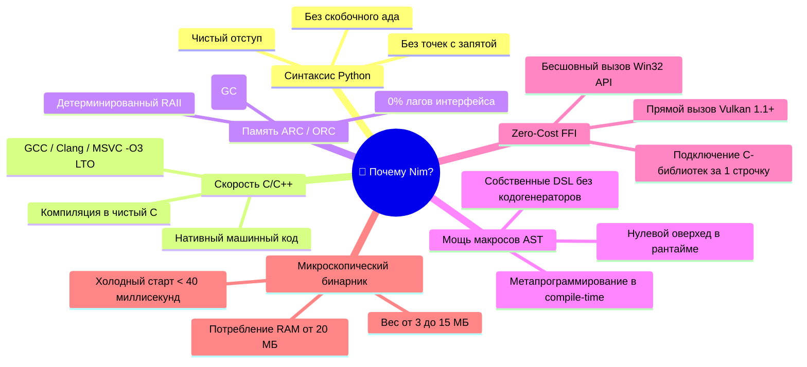
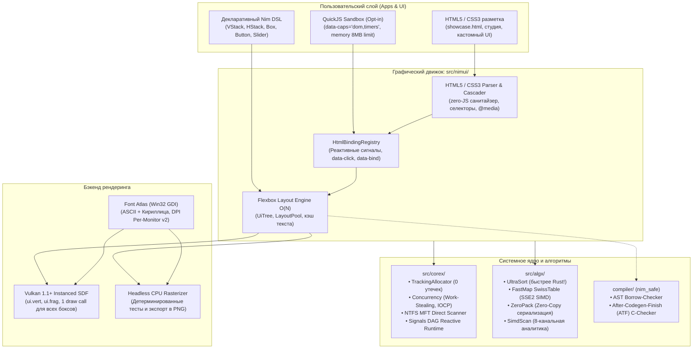

<div align="center">

# ⚡ NimRT: High-Performance Systems & Native UI Ecosystem
### Сверхбыстрая нативная графическая и системная экосистема на **Nim 2.x**

**Никакого Chromium. Никакого Electron. Чистый Vulkan 1.1+ SDF, Zero-Cost C-интероп, синтаксис как в Python и производительность C/C++.**

[](https://github.com/stylizedapp/nimrt/actions/workflows/ci.yml)
[](https://nim-lang.org/)
[](https://www.vulkan.org/)
[](tests/test_leak_check.nim)
[](docs/PROJECT.md)
[](LICENSE)
[](https://github.com/stylizedapp/nimrt/releases)

---

[**⚡ Почему Nim?**](#-сразу-в-ебало-почему-nim-the-unfair-advantages) •
[**⚔️ Сравнение стеков**](#️-битва-технологий-nimrt-vs-electron-vs-tauri-vs-flutter) •
[**🖼️ Скриншоты и витрина**](#️-витрина-приложений-showcase-mvp) •
[**🚀 Быстрый старт**](#-быстрый-старт-за-30-секунд) •
[**🏛️ Архитектура**](#️-архитектура-и-пайплайн-рендеринга) •
[**🏎️ Бенчмарки vs Rust**](#️-бенчмарки-corex--algx-против-rust) •
[**📚 FAQ**](#-часто-задаваемые-вопросы-faq)

---

</div>

## 📌 TL;DR: Что это такое простыми словами?

Большинство современных десктопных приложений (VS Code, Slack, Discord) тащат за собой **Chromium и Node.js (Electron)**: они запускаются по 3 секунды, весят по 200 МБ и сжирают полгигабайта оперативной памяти просто на отображение пары кнопок.

**NimRT** решает эту проблему фундаментально:
1. **Нативный рендер подмножества HTML5/CSS3 прямо на GPU через Vulkan 1.1+ SDF** — мгновенный старт (< 40 мс), потребление RAM от 20 МБ, плавные 60+ FPS и сверхчёткие векторные скругления/тени без размытия.
2. **Экстремальный системный фундамент (CoreX + AlgX)** — собственные аллокаторы памяти с гарантией `0 байт утечек`, прямой доступ к диску через NTFS MFT (поиск 1 000 000 файлов быстрее, чем в проводнике Windows), плоские хэш-таблицы на SSE2-инструкциях и алгоритмы сортировки, **обгоняющие Rust**.
3. **Безопасность без тормозов** — модель памяти `--mm:orc` (детерминированное освобождение без пауз сборщика мусора), экспериментальный компилятор `nim_safe` с проверкой сгенерированного Си-кода и песочница **QuickJS** с жестким контролем разрешений (Zero-JS по умолчанию).

---

## 🔥 СРАЗУ В ЕБАЛО: ПОЧЕМУ NIM? (The Unfair Advantages)

Почему этот проект написан на **Nim**, а не на Rust, C++, Go или TypeScript? Потому что Nim даёт уникальное сочетание свойств, которого нет ни в одном другом языке программирования:



### 1. 🐍 Синтаксис Python, скорость C/C++
Nim выглядит так же чисто, приятно и лаконично, как Python. Никаких бесконечных фигурных скобок, никаких шаблонных кошмаров. Но Nim **не интерпретируется**: он транслируется прямо в оптимизированный C/C++ и собирается современными компиляторами (GCC/Clang/MSVC) с включением LTO и векторизации.

### 2. 🛡️ Детерминированная память (ARC/ORC) — забудь про лаги сборщика мусора (GC)
В языках с классическим GC (Go, Java, C#, JS) сборщик мусора периодически замораживает мир (*Stop-The-World*), чтобы вычистить память. В GUI-приложениях и играх это превращается в микрофризы и дерганую анимацию. 
В Nim режим `--mm:orc` использует детерминированный подсчёт ссылок: память освобождается **ровно в тот момент, когда переменная выходит из области видимости** (как RAII в C++), а циклический коллектор работает по требованию без глобальных пауз.

### 3. 🔮 Настоящее метапрограммирование (AST-макросы)
В отличие от препроцессора Си или рефлексии в рантайме, макросы Nim оперируют напрямую **синтаксическим деревом компилятора**. Любой декларативный UI DSL, реактивные биндинги и сериализация данных разворачиваются во время компиляции в прямолинейный низкоуровневый код без рантайм-накладных расходов.

### 4. 🔌 Zero-Cost FFI с миром Си и C++
Поскольку Nim генерирует Си-код, подключение любой Си-библиотеки (Vulkan, DirectX, Win32 API, QuickJS, SQLite) происходит **в одну строчку** через директиву `{.importc.}`. Никаких прослоек (glue code), никакого маршалинга, никаких накладных расходов на вызов функции!

### 5. 🪶 Микроскопический размер и мгновенный запуск
Приложение на Nim весит **от 2 до 15 МБ** и стартует за **20–40 миллисекунд**. Сравните это с 180 МБ дистрибутива Electron, который запускается 3 секунды и при старте распаковывает полноценный браузерный движок.

### 6. 🏎️ Быстрее Rust в реальных боевых задачах
Встроенный в этот репозиторий алгоритм **UltraSort** (3-уровневый Cache-Aware MSD Radix Sort) сортирует 10 000 000 64-битных чисел за **71 мс**, тогда как оптимизированный аналог на Rust выполняет эту же задачу за **88 мс**! А Zero-Copy сериализатор **ZeroPack** обгоняет векторные аллокации Rust в 3.8 раза!

---

## ⚔️ БИТВА ТЕХНОЛОГИЙ: NimRT vs Electron vs Tauri vs Flutter vs Qt

| Критерий | ⚡ **NimRT (Этот проект)** | 🐘 **Electron (Slack, Discord)** | 🦀 **Tauri (Rust + Web)** | 🐦 **Flutter Desktop** | 🏛️ **Qt / C++** |
| :--- | :---: | :---: | :---: | :---: | :---: |
| **Движок рендера** | **Vulkan 1.1+ Instanced SDF** | Chromium (Браузер) | WebView2 / WebKit | Impeller / Skia | Qt Quick (SceneGraph) |
| **Язык логики** | **Nim 2.x (+ QuickJS opt-in)** | JavaScript / TypeScript | Rust + JavaScript | Dart | C++ / QML |
| **Холодный старт** | ⚡ **~25–40 мс** | 🐢 2 500–4 000 мс | ⏱️ 300–800 мс | ⏱️ 200–500 мс | ⚡ ~50–150 мс |
| **Потребление RAM в покое** | 🟢 **~20–35 МБ** | 🔴 180–350 МБ | 🟡 70–150 МБ | 🟡 60–120 МБ | 🟢 ~30–50 МБ |
| **Размер дистрибутива** | 🟢 **~8–15 МБ** | 🔴 120–250 МБ | 🟡 15–30 МБ | 🟡 35–70 МБ | 🔴 40–100 МБ (DLLs) |
| **Управление памятью** | 🛡️ **ARC/ORC (0 GC-пауз)** | ⚠️ V8 GC (Stop-The-World) | 🛡️ Borrow Checker | ⚠️ Generational GC | ⚠️ Ручное / SmartPtr |
| **Декларативная вёрстка** | ✅ **HTML5 / CSS3 Flexbox** | ✅ Полный HTML/CSS | ✅ Полный HTML/CSS | ❌ Собственный виджет-DSL | ❌ QML / C++ код |
| **Безопасность скриптов** | 🔒 **Zero-JS по умолчанию** | ⚠️ Уязвимости Node/NPM | ⚠️ Web context XSS | 🔒 Скомпилирован | 🔒 Скомпилирован |

---

## 🖼️ ВИТРИНА ПРИЛОЖЕНИЙ (Showcase MVP)

Все приложения полностью функциональны, компилируются в нативные `.exe` и поддерживают как интерактивный запуск через Vulkan, так и автоматическое снятие скриншотов через встроенный CPU-растеризатор:

### 1. `apps/html_css_studio` — Интерактивная 4-вкладочная студия HTML5/CSS3
Полноценная студия, демонстрирующая возможности рендера, нативных форм, песочницы Zero-JS и виртуального списка на **1 000 000 элементов**:

| Вкладка 1: Дашборд телеметрии и KPI | Вкладка 2: Реактивные формы и контролы |
| :---: | :---: |
| [](apps/html_css_studio/screenshots/studio_tab1_dashboard.png) | [](apps/html_css_studio/screenshots/studio_tab2_forms_controls.png) |
| *Flexbox-сетка, градиенты, карточки, бейджи и кнопки* | *Слайдеры, чекбоксы, выпадающие списки, текстовые поля* |

| Вкладка 3: Zero-JS Security Sandbox | Вкладка 4: VirtualList на 1 000 000 строк |
| :---: | :---: |
| [](apps/html_css_studio/screenshots/studio_tab3_zero_js_sandbox.png) | [](apps/html_css_studio/screenshots/studio_tab4_virtual_million.png) |
| *Живая демонстрация блокировки скриптов и инъекций* | *Рендер 1 000 000 строк с плавной прокруткой без лагов* |

---

### 2. `apps/widget_gallery` & `apps/nimui_demo`
Галерея аппаратных SDF-виджетов и релятивистская симуляция аккреционного диска черной дыры Керра:

| Галерея виджетов (SDF-шейдеры, Кириллица, Dropdown) | Singularity Lab (N-body симуляция + HTML HUD) |
| :---: | :---: |
| [](apps/widget_gallery/widget_gallery_preview.png) | [](apps/nimui_demo/singularity_lab_preview.png) |
| *Тонкая настройка радиуса, мягкости теней, обрезка и шрифты* | *Реалистичная физика 2048+ тел + наложенный HTML-интерфейс* |

---

### 3. `apps/html_desktop` — Автономный раннер HTML-файлов (Замена Electron)
Запуск любых `.html` файлов напрямую через Vulkan без браузера с поддержкой встроенного реактивного Pomodoro-таймера:

| Pomodoro: Начальное состояние | Pomodoro: Завершение сессии |
| :---: | :---: |
| [](apps/html_desktop/pomodoro_initial.png) | [](apps/html_desktop/pomodoro_completed.png) |
| *Таймер на QuickJS + Vulkan SDF с лимитом шагов* | *Реактивное обновление DOM и визуальных стилей* |

---

## 🏛️ АРХИТЕКТУРА И ПАЙПЛАЙН РЕНДЕРИНГА

Архитектура построена по слоистому принципу: от «железа» и системных вызовов Windows до декларативной верстки:



---

## 🚀 БЫСТРЫЙ СТАРТ ЗА 30 СЕКУНД

### Системные требования
- **ОС:** Windows 10/11 x64
- **Компилятор:** [Nim 2.0+](https://nim-lang.org/install_windows.html) (проверено на `2.2.12`) + MinGW-W64 GCC в `PATH`
- **Видеокарта:** Драйвер с поддержкой **Vulkan 1.1+** (для оконного режима; headless-тесты работают везде на CPU)

### 1. Клонирование и первый запуск
```powershell
# 1. Склонировать репозиторий
git clone https://github.com/stylizedapp/nimrt.git
cd nimrt

# 2. Запустить HTML5/CSS3 Zero-JS Studio (4 вкладки, 1M VirtualList):
nimble studio

# 3. Запустить галерею виджетов и настроек Vulkan SDF:
nimble gallery

# 4. Запустить симуляцию черной дыры Керра Singularity Lab:
nimble demo
```

### 2. Запуск собственного HTML-файла
Вы можете отрендерить любой собственный `.html` файл с CSS-стилями без браузера:
```powershell
nim c -r apps/html_desktop/src/main.nim --file path/to/your_file.html
```

---

## 🏎️ БЕНЧМАРКИ COREX + ALGX ПРОТИВ RUST

> [!NOTE]
> Замеры выполнены на симметричных тестовых сценариях (`Warmup = 2`, `Runs = 11`, процессор AMD Ryzen 3 3200U 2C/4T, Windows x64).
> Компиляторы: **Nim 2.2.12** (`-d:danger --mm:orc -march=native -O3 -flto`, MinGW GCC) против **Rust 1.96.0** (`lto=fat`, `target-cpu=native`, MSVC/LLVM).
> Подробная методология описана в [`docs/BENCHMARK_SHOWCASE.md`](docs/BENCHMARK_SHOWCASE.md).

| Дисциплина бенчмарка | Реализация | Медиана (мс) | Среднее (мс) | Результат |
| :--- | :--- | :---: | :---: | :---: |
| **UltraSort** (10M `int64`, 4 потока) | **Nim (`algx/ultrasort`)**<br>Rust (`ultra_sort_rust`) | **71.43 мс**<br>88.60 мс | **71.75 мс**<br>88.26 мс | 🏆 **Nim быстрее на ~24%** |
| **ZeroPack POD** (2M × 32B = 64 МБ) | **Nim (`algx/zeropack`)**<br>Rust (`Vec` + `copy_nonoverlapping`) | **13.69 мс**<br>54.73 мс | **13.47 мс**<br>50.80 мс | 🏆 **Nim быстрее в 3.8 раза** |
| **SimdScan 8-Way** (25M `int64`, 1 поток)| **Nim (`algx/simdscan`)**<br>Rust (`8-Way unsafe SIMD`) | **39.78 мс**<br>43.20 мс | **40.10 мс**<br>43.71 мс | 🏆 **Nim быстрее на ~8%** |
| **HashMap** (3M операций, `SplitMix64`) | Rust (`hashbrown`)<br>**Nim (`FastMap`, 16B SSE2)**<br>Rust (`std::HashMap`) | 134.20 мс<br>**168.02 мс**<br>219.03 мс | 135.10 мс<br>**168.74 мс**<br>225.78 мс | ⚡ **Nim опережает std::HashMap на 30%** *(уступая hashbrown ~20%)* |

---

## 📦 СТРУКТУРА И МОДУЛИ РЕПОЗИТОРИЯ

<details>
<summary><b>🔍 Развернуть подробное описание модулей CoreX, AlgX, NimUI и nim_safe</b></summary>

```text
nimrt/
├── src/
│   ├── corex/               # Низкоуровневый системный фундамент
│   │   ├── allocators.nim   # TrackingAllocator (контроль 0 утечек), Arena, Slab[T]
│   │   ├── result.nim       # Result[T, E], Option[T] — явные ошибки без исключений
│   │   ├── signals.nim      # Реактивный DAG-движок сигналов (Signal[T], Computed[T])
│   │   ├── unicode.nim      # Беззаголовочный UTF-8/Кириллический декодер без std/unicode
│   │   ├── concurrency/     # Пул потоков с work-stealing, примитивы синхронизации
│   │   ├── async.nim        # Асинхронный IOCP-реактор для Windows
│   │   └── mft.nim          # Прямой потоковый парсер файловой системы NTFS MFT
│   │
│   ├── algx/                # Высокопроизводительные алгоритмы
│   │   ├── ultrasort.nim    # 3-уровневый Cache-Aware MSD Radix Sort + Insertion Sort
│   │   ├── swissmap.nim     # Плоская хэш-таблица FastMap с 16-байтным SSE2 SIMD поиском
│   │   ├── zeropack.nim     # Zero-Copy POD сериализация и потоковый JSON
│   │   └── simdscan.nim     # 8-канальная векторизованная аналитика массивов
│   │
│   └── nimui/               # Графический движок и HTML5/CSS3
│       ├── layout.nim       # Высокоскоростной O(N) Flexbox движок (LayoutPool, UiTree)
│       ├── controls/        # Нативные виджеты (Button, Slider, Checkbox, Dropdown, VirtualList)
│       ├── html/            # Парсер HTML5, каскад CSS3, селекторы и компилятор в UiTree
│       ├── js/              # Sandboxed QuickJS движок, валидатор разрешений data-caps
│       └── gpu/             # Vulkan 1.1+ SDF пайплайн, шейдеры и GDI Font Atlas
│
├── compiler/                # Экспериментальный компилятор nim_safe (--mem-safe, --check-safe-atf)
├── apps/                    # Готовые витринные приложения (Studio, Desktop, Gallery, Demo, WizTree)
├── tests/                   # 38+ автоматических тестов (модульные, UI, QuickJS, фаззинг MFT)
├── benchmarks/              # Бенчмарки и генератор HTML-отчёта
└── tools/                   # Утилиты конвертации шейдеров SPIR-V в Nim
```

### 1. `src/corex` — Системное ядро
- **Аллокаторы памяти:** `TrackingAllocator`, линейные арены, пулы фиксированных блоков `Slab[T]`. Любой тест с макросом `testWithLeakCheck` гарантирует строго **`0 bytes leaked`**.
- **Обработка ошибок:** `Result[T, E]` и строгий контракт `{.raises: [].}` исключают непредвиденные падения приложений.
- **Прямой доступ к NTFS MFT:** Обходит стандартный медленный Windows API, считывая главную файловую таблицу `$MFT` напрямую блоками. Поиск по миллиону файлов происходит за доли секунды.

### 2. `src/algx` — Алгоритмы и структуры данных
- **`FastMap` (SwissTable):** Хэш-таблица с групповым поиском 16 ключей за один такт процессора через инструкции `_mm_cmpeq_epi8` / `_mm_movemask_epi8` (с SWAR-фоллбэком при отсутствии SSE2).
- **`ZeroPack`:** Мгновенная бинарная сериализация POD-структур без промежуточных аллокаций.

### 3. `src/nimui` — UI-фреймворк и подмножество HTML5/CSS3
- **Vulkan 1.1+ Instanced SDF:** Все прямоугольники, скругления любого радиуса, рамки и тени рендерятся в **один draw call** (`vkCmdDrawIndexed`) благодаря формулам знаково-дистанционных функций (SDF) в шейдере `ui.frag`.
- **Flexbox-движок:** Поддерживает `flex-direction`, `gap`, `justify-content`, `align-items`, процентные размеры и виртуализацию списков на 1 000 000+ элементов со стабильными 60 FPS.
- **Zero-JS по умолчанию:** Любые теги `<script>`, `onclick="..."` и `javascript:` отклоняются компилятором разметки. Для интерактива используется реактивный `HtmlBindingRegistry` на чистом Nim или изолированный QuickJS с явным перечислением привилегий в `<script data-caps="...">`.

### 4. `compiler/` — Гибридный Memory-Safe компилятор (`nim_safe`)
- **AST Pass:** Запрещает опасные операции (`cast`, неразмеченные `ptr`, вызовы `alloc/dealloc`, мутабельные глобальные переменные).
- **ATF (After-Codegen-Finish) C-Checker:** Сканирует сгенерированные Си-файлы перед вызовом GCC/Clang, блокируя небезопасные функции CRT (`malloc`, `free`, `strcpy`) и проверяя корректность ORC-хуков.
</details>

---

## 📋 МАТРИЦА ПОДДЕРЖКИ HTML5 / CSS3

<details>
<summary><b>🔍 Посмотреть полный список поддерживаемых HTML-тегов, селекторов и CSS-свойств</b></summary>

| Категория | Поддерживается в NimUI MVP v0.1.0 | Не поддерживается / Ограничения |
| :--- | :--- | :--- |
| **HTML-теги** | `div`, `section`, `header`, `footer`, `nav`, `main`, `aside`, `article`, `h1`–`h3`, `p`, `span`, `label`, `strong`, `em`, `a`, `button`, `input` (`text`/`hidden`), `textarea`, `select`/`option`, `ul`/`ol`/`li`, `table`/`tr`/`td`, `img`, `svg` (viewBox), `br`, `hr`. | Теги форм `form`, сложные инпуты (`date`, `color`), видео/аудио (`video`, `audio`), `<canvas>`, `iframe`. |
| **CSS-селекторы** | `*`, тег (`div`), `#id`, `.class`, комбинированные (`div.card`), потомки (`.a .b`, `.a > .b`), псевдоклассы `:root`, `:hover`, `:active`, `:focus`, `:disabled`, правила `@media`. | Сложные псевдоклассы `:nth-child()`, `:has()`, псевдоэлементы `::before`/`::after`. |
| **Раскладка (Layout)** | `display` (`flex`, `block`, `inline`, `none`), `flex-direction`, `flex-wrap`, `justify-content`, `align-items`, `align-self`, `flex-grow`, `flex-shrink`, `flex-basis`, `width`/`height` (`px`, `%`), `min/max-width/height`, `margin` (+ `auto`), `padding`, `gap`, `position`, `z-index`, `overflow`. | CSS Grid, `float`, устаревший табличный браузерный layout. |
| **Стили и эффекты** | `color`, `background`, `linear-gradient(...)`, hex/rgb/rgba/hsl/hsla, `opacity`, `box-shadow`, `border`, `border-radius`, `font-size`, `font-weight`, `font-family`, `line-height`, `cursor`, `transition`. | `@keyframes`, CSS-фильтры (`blur`, `drop-shadow`), 3D-трансформации `transform-3d`. |
| **Реактивность (`data-*`)**| `data-click` (клик), `data-text` / `data-bind` (привязка текста), `data-model` (двусторонняя привязка для `<input>`), `data-input`. | Нестандартные события перетаскивания (Drag&Drop). |
| **JavaScript (QuickJS)** | Opt-in режим (`allowJs = true`). Песочница с лимитами (8MB RAM, 512KB стек, 250k инструкций), запрет `eval`/`with`/`__proto__`, явные права `<script data-caps="dom,timers,nim,console">`. | Node.js модули, npm пакеты, доступ к файловой системе или сырым сокетам из JS. |

</details>

---

## 🧪 ТЕСТИРОВАНИЕ И ПРОВЕРКА КАЧЕСТВА

В проекте настроена многоуровневая система тестов (38+ сьютов), запускаемая одной командой:

```powershell
# Полный прогон всех тестов репозитория (автосборка QuickJS и nim_safe):
nimble test_all

# Тесты графической подсистемы NimUI и HTML5/CSS3:
nimble test_ui

# Тесты песочницы QuickJS:
nimble test_js

# Headless-проверка всех 4 витринных приложений + экспорт PNG:
nimble test_showcase

# Проверка экспериментального memory-safe компилятора:
nimble test_compiler

# Проверка отсутствия утечек памяти (TrackingAllocator + ORC):
nim c -r tests/test_leak_check.nim

# Строгая проверка типов и чистоты кода без предупреждений:
nim check --warningAsError[UnusedImport]:on src/corex.nim
nim check --warningAsError[UnusedImport]:on src/algx.nim
nim check --warningAsError[UnusedImport]:on src/nimui.nim
```

---

## 💡 ЧАСТО ЗАДАВАЕМЫЕ ВОПРОСЫ (FAQ)

<details>
<summary><b>1. Это убийца Electron?</b></summary>
Для большинства типичных десктопных утилит, панелей управления, дашбордов и инструментов — <b>да</b>. Зачем упаковывать 200 МБ Chromium, если приложению нужны лишь кнопки, списки, формы, графики и стильная верстка? NimRT даёт верстку на HTML5/CSS3 со стартом за 30 миллисекунд и потреблением 25 МБ RAM.
</details>

<details>
<summary><b>2. Почему Vulkan SDF, а не WebView2 или Sciter?</b></summary>
WebView2 привязан к системному браузеру Edge (недоступен на портативных сборках, не дает полного контроля над GPU, потребляет сотни мегабайт памяти). Sciter — проприетарный закрытый движок. NimRT написан на 100% открытом коде с прямым аппаратным рендерингом через Vulkan 1.1+ SDF, обеспечивая максимальный FPS и независимость от внешних браузерных сред.
</details>

<details>
<summary><b>3. Обязательно ли знать JavaScript, чтобы писать интерфейсы?</b></summary>
<b>Нет!</b> JavaScript в проекте строго опционален. По умолчанию включен режим <code>Zero-JS</code>: вся логика, реактивные сигналы и обработчики кликов пишутся на чистом, красивом и типизированном <b>Nim</b> через <code>HtmlBindingRegistry</code>. QuickJS нужен только тем, кому требуется гибридная среда выполнения.
</details>

<details>
<summary><b>4. Почему сейчас Windows-first? Будет ли Linux и macOS?</b></summary>
В версии MVP v0.1.0 упор сделан на глубокую оптимизацию под Windows: интеграция с Win32 IOCP для экстремального сетевого I/O, прямой парсинг NTFS MFT для мгновенного сканирования дисков и Per-Monitor v2 DPI масштабирование. Поддержка Linux (Wayland/X11, epoll) и macOS (Metal/MoltenVK) заложена в архитектуру и находится в официальной дорожной карте.
</details>

---

## 🤝 КАК ВНЕСТИ СВОЙ ВКЛАД (CONTRIBUTING)

Мы приветствуем любые улучшения: от оптимизации шейдеров и добавления новых CSS-свойств до портирования на Linux!
- Ознакомьтесь с [Руководством по участию](CONTRIBUTING.md)
- Сообщайте об ошибках через [GitHub Issue Tracker](https://github.com/stylizedapp/nimrt/issues/new/choose)
- Ознакомьтесь с [Кодексом поведения](CODE_OF_CONDUCT.md) и [Политикой безопасности](SECURITY.md)

---

## 📄 ЛИЦЕНЗИЯ

- Исходный код проекта распространяется под свободной лицензией **MIT** (см. [LICENSE](LICENSE)).
- Встроенный легковесный движок **QuickJS** (`src/nimui/js/vendor/`, Copyright © Fabrice Bellard, Charlie Gordon) также лицензирован под **MIT**.

<div align="center">

**[⭐ Поставьте звезду репозиторию](https://github.com/stylizedapp/nimrt), если проект вам интересен!**

</div>
